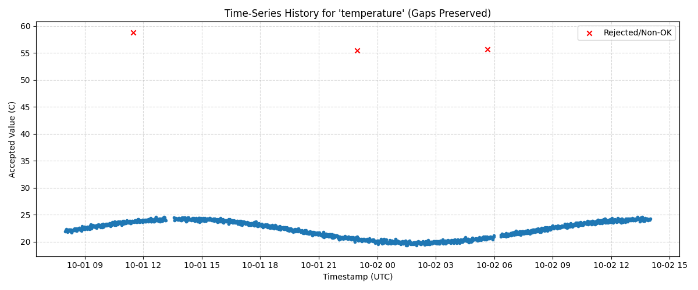

# Module 6 Assignment Report — History Builder: SQLite Logging and Honest Time-Series Reporting

## 1. Sensor and Dataset Overview
- **Sensor(s) Analyzed:** Temperature, Humidity, Light, Distance, Potentiometer
- **Units:** Temperature (°C), Humidity (%), Light (raw counts), Distance (cm), Potentiometer (%)
- **Source File:** `module6_sample_sensor_history.csv` (1,756 records)
- **Total Input Records:** 1,756 records

## 2. Timestamp Method
- **Timestamp Source:** Original timestamps present in the dataset (ranging from `2026-10-01 08:00:00 UTC` to `2026-10-02 14:00:00 UTC`).
  > *Note:* If using a raw sensor stream lacking original timestamps (such as `velxio_sample_sensor_readings.csv`), timestamps are reconstructed for classroom replay starting at `2026-10-01 12:00:00 UTC` with a documented sampling interval of 2 seconds and clearly tagged as `RECONSTRUCTED`.
- **Expected Sampling Interval:** 60 seconds (1 minute) for the primary dataset / 2 seconds for the classroom replay dataset.

## 3. Database Design
- **Database Filename:** `module6_sensor_history.db`
- **Table Name:** `sensor_readings`
- **Field Architecture & Traceability:**
  - `id`: `INTEGER PRIMARY KEY AUTOINCREMENT` — Unique identifier for each database entry.
  - `sample_number`: `INTEGER` — Sequence index maintained from the original sensor data stream.
  - `timestamp`: `TEXT` — ISO-8601 formatted timestamp string for reliable time-window indexing and querying.
  - `sensor_name`: `TEXT` — Name identifying the specific physical or virtual sensor.
  - `raw_value`: `REAL` — Unmodified reading observed directly from the sensor stream.
  - `accepted_value`: `REAL` — Validated reading retained only when status is verified as `OK` (`NULL`/`NaN` otherwise).
  - `status`: `TEXT` — Operational status classification (e.g., `OK`, `OUT_OF_RANGE`, `MISSING`, `UNCLASSIFIED`).
  - `unit`: `TEXT` — Engineering measurement unit associated with the sensor.
  - `timestamp_source`: `TEXT` — Explicit label (`ORIGINAL` or `RECONSTRUCTED`) ensuring honest data provenance.

## 4. Time-Window Reports
All time-window queries are calculated dynamically relative to the latest timestamp stored in the database (`2026-10-02 14:00:00 UTC`):

| Report Name | Time Boundary | Record Count | Key Observations |
| :--- | :--- | :--- | :--- |
| **Last-Hour Report** | `>= 2026-10-02 13:00:00 UTC` | 61 | 100% complete continuous stream; zero missing intervals detected. |
| **Last-Day Report** | `>= 2026-10-01 14:00:00 UTC` | 1,421 | Captures the main operating history including 1 major missing data interval. |
| **Full-History Report** | Full Dataset Range | 1,756 | Covers the complete 30-hour sensor run containing all 2 detected data gaps. |

## 5. Data Completeness & Gap Analysis
A gap is defined as any elapsed time between consecutive sensor readings exceeding **1.5 times the expected sampling interval** (>90 seconds for a 60s interval):

- **Expected Readings:** 1,801 total expected readings across the 30-hour span.
- **Received Readings:** 1,756 actual recorded readings.
- **Missing Readings Estimate:** 45 missing readings.
- **Data Completeness Percentage:** 97.50%
- **Detected Gaps:** 2 distinct missing transmission intervals:
  1. **Gap 1:** 1,560 seconds (26 minutes) on `2026-10-01` between 13:09:00 and 13:35:00 UTC.
  2. **Gap 2:** 1,260 seconds (21 minutes) on `2026-10-02` between 05:59:00 and 06:20:00 UTC.
- **Largest Detected Gap:** 1,560 seconds (26 minutes).

## 6. Time-Series Plot Interpretation

- **Preserving Missing Intervals:** Line segments are explicitly disconnected across any time delta exceeding the gap threshold. The plot displays discrete, continuous segments during active monitoring, leaving empty spaces where data is missing.
- **Honest Reporting Principles:** The plot clearly demonstrates where evidence exists and where missing data prevents drawing conclusions. It does not smooth or interpolate across missing intervals.
- **What the Plot Does NOT Prove:** The plot cannot prove what physical conditions existed during the 26-minute or 21-minute data gaps. Connecting the points directly or calculating a naive average across missing periods would create a false representation of uninterrupted stability.

## 7. Automated Testing Summary
- **Automated Test 1 (SQLite Logging Test):** Verifies that the row count in the SQLite database table matches the processed Pandas DataFrame row count exactly (`Pass: 1,756 == 1,756`).
- **Automated Test 2 (Gap Detection & Completeness Test):** Validates that calculated completeness percentages fall within valid boundaries (`0% <= completeness <= 100%`) and that gap deltas correctly identify missing periods exceeding 1.5x expected interval.

## 8. Known Limitations
- **Reconstructed Time Bounds:** Reconstructed timestamps reflect ideal classroom replay intervals rather than physical hardware clock drift.
- **Unobserved Failure Modes:** The root cause of network/power outages during missing periods cannot be determined purely from stored telemetry.